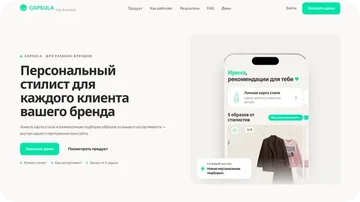

<!--
  GitHub profile README — mirrosha26
  Green links = SVG text (transparent) — GitHub strips CSS link colors.
  Rounded cards = radius baked into WebP alpha.
-->

  

<h1 align="center">Mikhail Miroshnikov</h1>

  full-stack developer · co-founder of <b>VECK</b> 
  (⌒‿⌒)

  Moscow · building products end to end — backend, UI, and the bits in between

  
  ·
  
  ·
  

### Stack

  

  
    <code>React</code> ·
    <code>Next.js</code> ·
    <code>TypeScript</code> ·
    <code>Django</code> ·
    <code>PostgreSQL</code> ·
    <code>Docker</code> ·
    <code>Tailwind</code> ·
    <code>Figma</code>
  

### Selected work

<table border="0" cellspacing="0" cellpadding="6" width="100%">
  <tr>
    <td width="33%" valign="top" align="center">
      
       
      
       
      B2B SaaS · venture · 2024–2026
    </td>
    <td width="33%" valign="top" align="center">
      
       
      
       
      Fashion e-com · inventory · 2026
    </td>
    <td width="33%" valign="top" align="center">
      
       
      
       
      Telegram analytics + AI · 2026
    </td>
  </tr>
  <tr>
    <td width="33%" valign="top" align="center">
      
       
      
       
      Cabinet · API · styling · 2024–2026
    </td>
    <td width="33%" valign="top" align="center">
      
       
      
       
      B2B styling platform · 2025–2026
    </td>
    <td width="33%" valign="top" align="center">
      
       
      
       
      Salut UI/UX for Capsula · 2022
    </td>
  </tr>
</table>

  

  thanks for stopping by (⌒‿⌒)

