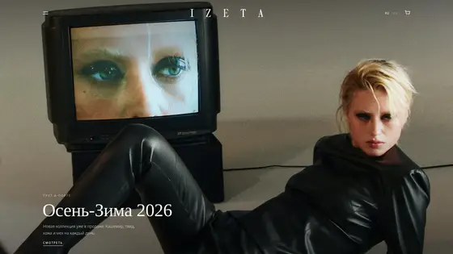

<!--
  GitHub profile README — mirrosha26
  Link color: GitHub strips CSS, so green labels via shields.io.
-->

  

<h1 align="center">Mikhail Miroshnikov</h1>

  full-stack developer · co-founder of <b>VECK</b> 
  (⌒‿⌒)

  Moscow · building products end to end — backend, UI, and the bits in between

  
  &nbsp;
  
  &nbsp;
  

---

### Stack

  

`React` · `Next.js` · `TypeScript` · `Django` · `PostgreSQL` · `Docker` · `Tailwind` · `Figma`

---

### Selected work

<table>
  <tr>
    <td width="50%" valign="top">
      
       
       
      B2B SaaS for venture investors · 2024–2026
    </td>
    <td width="50%" valign="top">
      
       
       
      Fashion e-commerce & inventory · 2026
    </td>
  </tr>
  <tr>
    <td width="50%" valign="top">
      
       
       
      Telegram analytics + AI · 2026
    </td>
    <td width="50%" valign="top">
      
       
       
      Cabinet, API & styling platform · 2024–2026
    </td>
  </tr>
</table>

  

---

  thanks for stopping by (⌒‿⌒)

