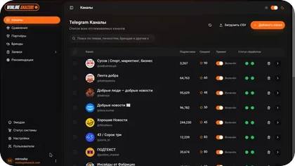

<!--
  GitHub profile README — mirrosha26
  Markdown "magic" that survives the sanitizer:
  - green links  → shields.io (inline CSS colors get stripped)
  - rounded cards → radius baked into WebP alpha (border-radius stripped)
  - 3-col grid   → HTML table + % widths (no CSS grid)
-->

  

<h1 align="center">Mikhail Miroshnikov</h1>

  full-stack developer · co-founder of <b>VECK</b> 
  (⌒‿⌒)

  Moscow · building products end to end — backend, UI, and the bits in between

  
  
  

---

### Stack

  

  <code>React</code>
  ·
  <code>Next.js</code>
  ·
  <code>TypeScript</code>
  ·
  <code>Django</code>
  ·
  <code>PostgreSQL</code>
  ·
  <code>Docker</code>
  ·
  <code>Tailwind</code>
  ·
  <code>Figma</code>

---

### Selected work

<table border="0" cellspacing="0" cellpadding="8" width="100%">
  <tr>
    <td width="33%" valign="top" align="center">
      
       
      
       
      B2B SaaS · venture · 2024–2026
    </td>
    <td width="33%" valign="top" align="center">
      
       
      
       
      Fashion e-com · inventory · 2026
    </td>
    <td width="33%" valign="top" align="center">
      
       
      
       
      Telegram analytics + AI · 2026
    </td>
  </tr>
  <tr>
    <td width="33%"></td>
    <td width="33%" valign="top" align="center">
      
       
      
       
      Cabinet · API · styling · 2024–2026
    </td>
    <td width="33%"></td>
  </tr>
</table>

  

---

  thanks for stopping by (⌒‿⌒)

