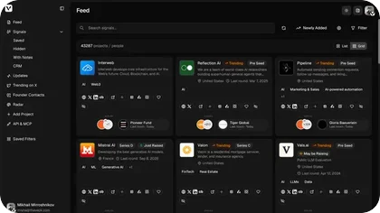

<!--
  GitHub profile README — mirrosha26
  Green links = SVG text (CSS colors stripped by GitHub).
  Rounded cards = radius baked into WebP alpha.
-->

  

<h1 align="center">Mikhail Miroshnikov</h1>

  full-stack developer · co-founder of <b>VECK</b> 
  (⌒‿⌒)

  Moscow · building products end to end — backend, UI, and the bits in between

  
  ·
  
  ·
  

 

  

 

  
  
  

  
  ·
  
  ·
  

 

  
  
  

  
  ·
  
  ·
  

 

  

  thanks for stopping by (⌒‿⌒)

